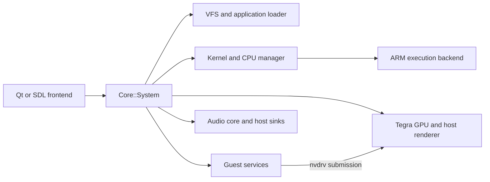

# Emulation lifecycle

## Architecture at a glance

## Desktop entry points

The Qt executable enters through [main.cpp](../../src/yuzu/main.cpp#L217), which constructs the Qt application and enters its event loop. Game launches converge in [MainWindow::BootGame](../../src/yuzu/main_window.cpp#L1946). The window checks firmware before calling `Core::System::Load` with the render window. After a successful load it creates and starts an `EmuThread`.

The command-line frontend uses SDL application callbacks. It supplies its own emulation window and application applet parameters to the same core loader, maps a failed load to SDL failure, and calls `System::Run` for a successful session. See the [CLI launch path](../../src/yuzu_cmd/yuzu.cpp#L432).

## Guest construction and teardown

[Core::System](../../src/core/core.cpp#L731) hands the load to its implementation. The implementation initializes the kernel, resolves the guest file through the virtual filesystem and asks the applet layer to create the guest process with a loader. It registers the process as the application, applies early title overrides, then initializes Host1x, GPU, audio and guest services. CPU manager initialization follows GPU setup, and the process is handed to the applet manager.

Loader failures and application subsystem setup failures both take a cleanup path before returning an error. During [shutdown](../../src/core/core.cpp#L510), the system notifies the GPU, requests stop, suspends emulation, closes guest services and shuts down the cores before releasing the GPU and audio objects.

Follow [Graphics and presentation](graphics.md) for GPU work, [Guest services and host I/O](guest-services.md) for IPC and host boundaries, and [Build and test Orchid](../development/build-and-test.md) for targets.

## System ownership

Core::System holds the kernel, clock, CPU manager, filesystem controller and HID core in a single implementation. The service collection, GPU, Host1x and audio objects are optional session components. When tracking a lifetime bug, distinguish the System object from the application resources that Load constructs and shutdown releases. [`core.cpp`](../../src/core/core.cpp#L586) [`core.cpp`](../../src/core/core.cpp#L510)

Run and Pause serialize transitions through the suspend guard. Run resumes the kernel and clock and clears the paused flag. Pause synchronously pauses timing before suspending the kernel. This boundary is shared by the desktop control paths. [`core.cpp`](../../src/core/core.cpp#L281) [`emu_thread.cpp`](../../src/qt_common/render/emu_thread.cpp#L48)

## How the modules fit

Application setup connects the frontends to the guest through three successive boundaries: select and initialize the process from a virtual file, initialize guest-facing services and host-facing devices, then initialize the CPU manager and register the process with the applet manager. Use the links below to follow each boundary into its owning module. [`core.cpp`](../../src/core/core.cpp#L335) [`core.cpp`](../../src/core/core.cpp#L398) [`core.cpp`](../../src/core/core.cpp#L446)

## Related pages

[CPU execution and Dynarmic](../architecture/cpu-jit.md) · [Kernel and HLE](../architecture/kernel.md) · [Guest IPC and services](../architecture/guest-services.md) · [Guest memory and address translation](../architecture/memory.md) · [GPU command processing](../architecture/graphics.md) · [Audio and host sinks](../architecture/audio.md) · [Input and HID](../architecture/input.md) · [Filesystem and application loading](../architecture/filesystem.md) · [Qt and SDL frontends](../architecture/frontends.md) · [Configuration and per-title settings](../architecture/configuration.md) · [Build, PGO and release](../development/build-and-test.md)
